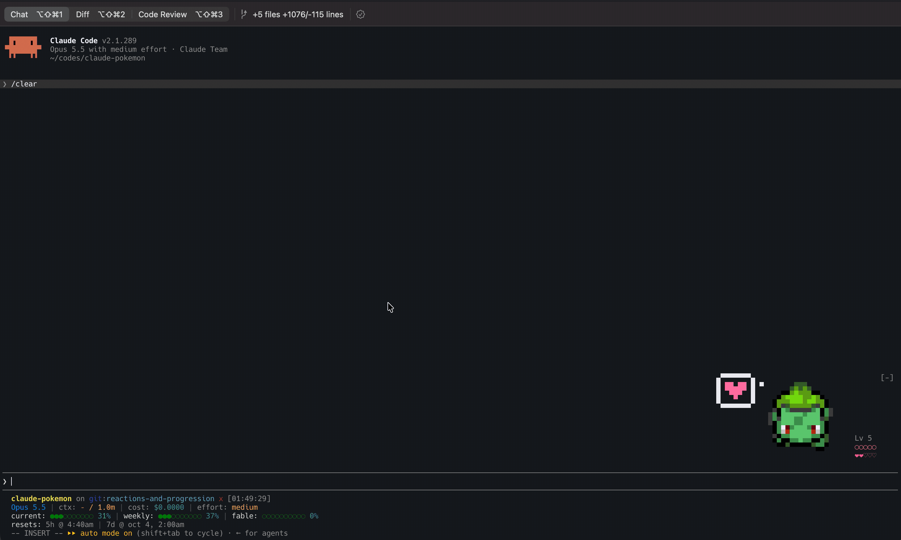
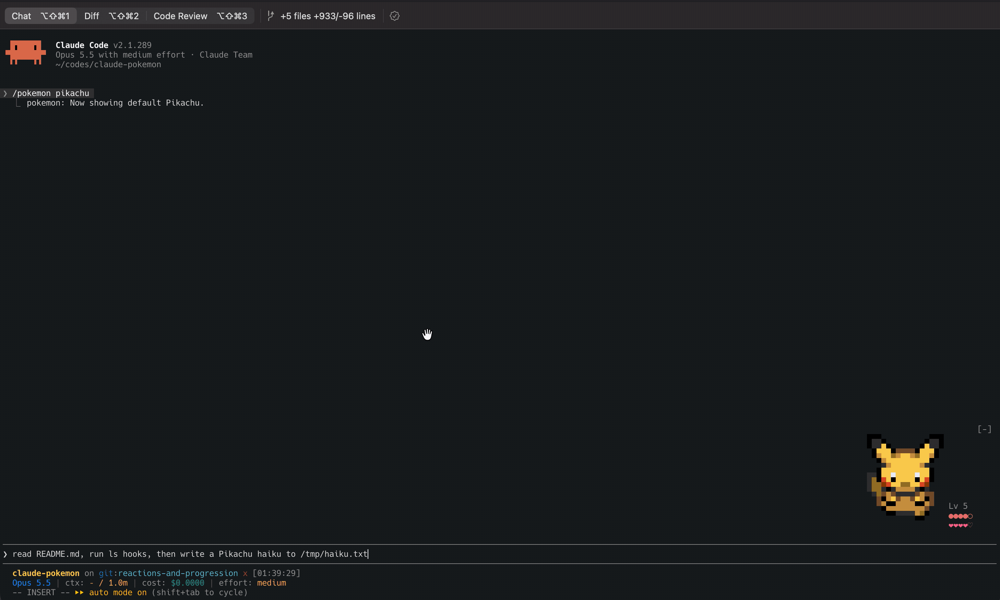
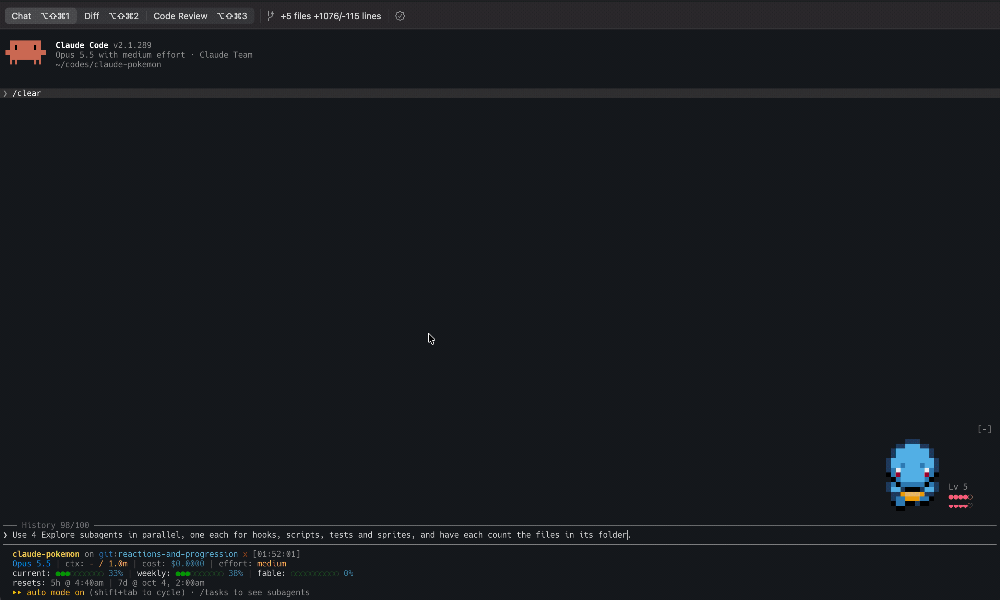
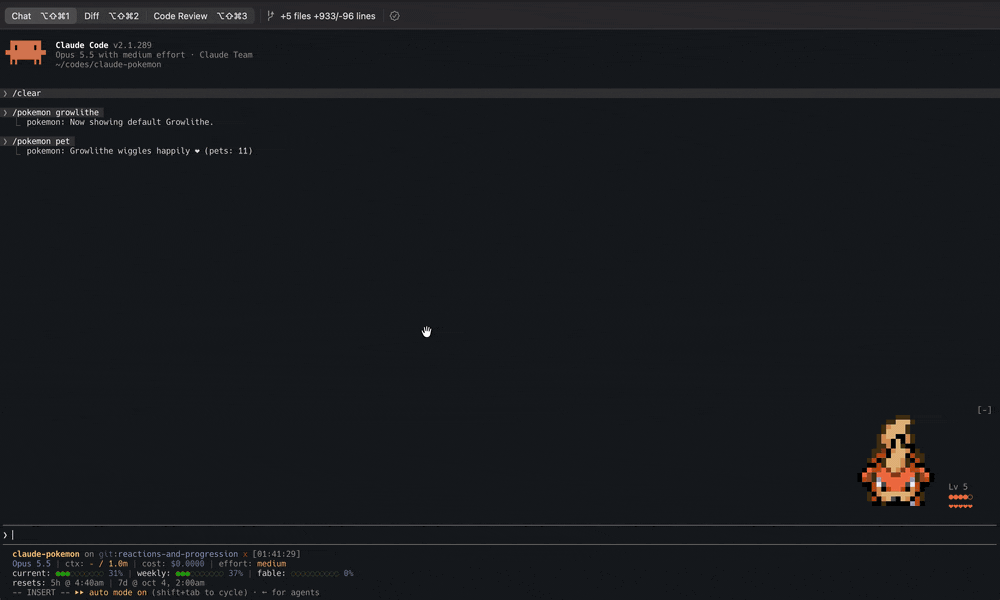
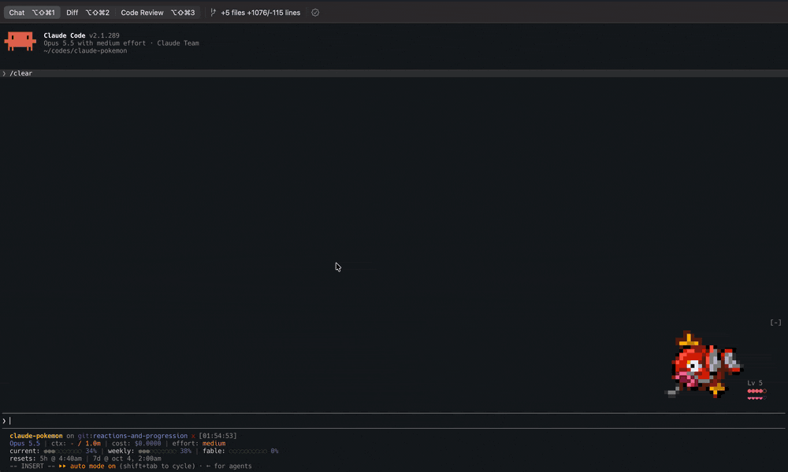

<div align="center">

# claude-pokemon

**A pixel Pokémon that lives above your Claude Code prompt and reacts to everything Claude does.**

[](https://github.com/dgokcin/claude-pokemon-mod/actions/workflows/ci.yml)
[](https://github.com/dgokcin/claude-pokemon-mod/releases)




</div>

```bash
claude plugin marketplace add dgokcin/claude-pokemon-mod
claude plugin install pokemon@claude-pokemon
```

Then pick your partner with `/pokemon <mon>`.

> [!TIP]
> It works best in kitty, Ghostty, or a recent iTerm2, which draw images, so the small band keeps every pixel. iTerm2 also needs images turned on in the `env` block of `~/.claude/settings.json`:
>
> ```json
> {
>   "env": {
>     "CLAUDE_CODE_FORCE_TERMINAL_IMAGES": "1"
>   }
> }
> ```

## Why you'll keep it on

- 🔎 **It watches Claude work.** A pencil for edits, a magnifier for reads, `>_` for shell commands, a TM disc for skills.
- ⚪ **Every subagent is a Poké Ball.** It drops when the subagent starts, a mon from your box steps out to work beside yours, and it goes back in when the subagent reports back.
- ❗ **It tells you when Claude needs you.** A red "!" for questions, plan approvals, and permission prompts.
- 💦 **It flinches when a tool fails.** A shake and a sweat drop, so you notice.
- 📈 **It levels up as you ship.** Every answered turn earns XP, and mons evolve at their levels from the games.
- 🫐 **It needs you too.** Feed it and pet it, or it gets hungry and lonely. Leave it long enough and it faints, and then it runs away.
- ⚡ **It fights.** 135 moves from gen 1, each with its own pixel animation.
- 🌿 **Wild Pokémon show up.** Your work wears them down, and `/pokemon catch` fills your Pokédex.
- 🎨 **All 151 gen 1 Pokémon**, each in default and shiny.

## See it

**Watch it follow Claude's tools.** A magnifier for reads, a pencil for writes, and a level-up when the answer lands.



**Run subagents and watch the balls drop.**



**Evolve it.** At the right level, or with a stone.



**Make it attack.** Magikarp uses Splash. Nothing happens. Gengar uses Night Shade.



## Commands

| Command | What it does |
| --- | --- |
| `/pokemon <mon>` | Pick a mon, like `/pokemon charmander` |
| `/pokemon pet` | Pet it |
| `/pokemon feed` | Toss it a berry |
| `/pokemon revive` | Take a fainted mon to a Pokémon Center |
| `/pokemon attack [move]` | Use a random move, or a named one like `thunderbolt` |
| `/pokemon evolve` | Evolve with a stone or a trade |
| `/pokemon stats` | Level, XP, evolution, and meters |
| `/pokemon box` | Every mon you've raised |
| `/pokemon party` | The mons that come out for subagents, and who each works for |
| `/pokemon party add <mon>` | Put a mon from your box in your party, like `/pokemon party add dratini` |
| `/pokemon party assign <agent> <mon>` | Send the same mon out for every subagent of a type, like `/pokemon party assign explore abra` |
| `/pokemon catch` | Throw a Poké Ball at a wild mon |
| `/pokemon dex` | Every wild mon you've seen and caught |
| `/pokemon new <mon>` | Fetch a mon from gen 2 to 5, like `/pokemon new mudkip`, or a random one with `/pokemon new gen3` |

<details>
<summary>All commands</summary>

| Command | Effect |
| --- | --- |
| `/pokemon` | Show the active mon, its variant, level, meters, and the options |
| `/pokemon <mon>` | Pick the mon for this session, or for every open session with `/pokemon sync` on. A new session starts with the one picked last |
| `/pokemon list` | List every mon name |
| `/pokemon help` | List every option and what it does, with each toggle's setting |
| `/pokemon shiny`, `/pokemon default` | Pick a variant, saved across sessions |
| `/pokemon wander` | Toggle idle wandering (on by default) |
| `/pokemon pet` | Pet the mon. A sleeping mon stays asleep. Counts pets across sessions |
| `/pokemon feed` | Toss it a random oran 🫐, pecha 🍑, razz 🍓, or sitrus 🍋 berry |
| `/pokemon attack` | Use a random move from the mon's moveset |
| `/pokemon attack <move>` | Use a named move, ignoring case, spaces, and dashes |
| `/pokemon moves`, `/pokemon attack list` | List the active mon's moves |
| `/pokemon moves <mon>` | List another mon's moves |
| `/pokemon evolve` | Evolve with a stone or a trade. Also evolves a mon at its level with autoevolve off, and restarts an evolution you cancelled |
| `/pokemon evolve <mon>` | Pick what Eevee becomes, like `/pokemon evolve jolteon` |
| `/pokemon stop` | Cancel an evolution |
| `/pokemon revive`, `/pokemon revive <mon>` | Take a fainted mon to a Pokémon Center. Nurse Joy heals it in 5 minutes, and it stands up at 50% food and 30% happiness |
| `/pokemon nuzlocke` | Toggle nuzlocke (off by default, saved across sessions). On, a mon that faints is gone for good |
| `/pokemon sleep` | Tuck the mon in, so its meters drain slower until Claude starts working in a session showing it. Run it again to wake it |
| `/pokemon needs` | Toggle food and happiness (on by default). Off, the faint and runaway clocks stop too |
| `/pokemon sync` | Toggle syncing the mon across sessions (off by default, saved across sessions). On, every open session switches to the mon picked last in any of them, fetched mons included. Off, each session keeps its own |
| `/pokemon autoevolve` | Toggle level evolutions starting on their own once idle (on by default). Off, the mon waits for `/pokemon evolve` |
| `/pokemon emoji` | Toggle emoji meters, 🍓 and 💗 instead of ● and ♥ (off by default, saved across sessions) |
| `/pokemon size small`, `/pokemon size large` | Draw the band at half size or full size (large by default, saved across sessions). A short pane still shrinks it further. See [How it works](#how-it-works) for crisp small mons in iTerm2 |
| `/pokemon images auto`, `on`, `off` | Draw the small band and the hearts as pixel images, or in half blocks and text (auto by default, saved across sessions). `auto` uses images only in kitty, Ghostty, and iTerm2 builds that draw them. `off` fixes a terminal that shows boxes, and `on` tries images in a terminal not on that list |
| `/pokemon pane` | Move the mon out of the band into a pane half the terminal wide, docked beside the transcript in the fullscreen layout so Claude's replies keep the left half. Run it again, or close the pane, to bring it back to the band (saved across sessions). On the main screen the pane sits above the prompt instead |
| `/pokemon stats` | Show the level, XP to the next one, how it evolves, the meters, and your pets and feeds |
| `/pokemon box` | List every mon you've raised, highest level first |
| `/pokemon party` | List your party, the mons in your box beside the one on show, highest level first, up to 5, and the subagent each one works for. Fainted mons, ones that ran away, and ones lost in a nuzlocke stay out of it |
| `/pokemon party add <mon>`, `/pokemon party remove <mon>` | Pick your party from your box, up to 5, saved across sessions. Mons come out in the order you added them. The first change starts from the party as it stands, and a mon you take out while it works finishes its subagent first |
| `/pokemon party assign <agent> <mon>`, `/pokemon party unassign <agent>` | Tie a mon from your box to an agent type, like `explore`, `plan`, or one of your own agents' names, so you can tell which agent is working or done by who steps out (saved across sessions). The mon comes out for that type alone, outside the party of 5, and a mon works for one type at a time, so assigning it again moves it. When it's busy with another subagent of its type, or fainted, that subagent gets the next mon from the party |
| `/pokemon new <mon>` | Fetch a mon from any generation in [vscode-pokemon](https://github.com/jakobhoeg/vscode-pokemon/tree/main/media) (gen 1 to 5) and show it. It's saved in the mod's store, so it stays through plugin updates and shows up in every session. Moves come from its types, using gen 1 animations |
| `/pokemon new random`, `/pokemon new gen<N>` | Fetch a random mon you don't have yet, from gen 2 to 5 or from gen N |
| `/pokemon nickname <name>` | Nickname the mon, up to 12 characters. It keeps the name when it evolves, and its species name takes the nickname away |
| `/pokemon release <mon>` | Release a mon from your box. It starts over at its first level with fresh meters |
| `/pokemon catch` | Throw a Poké Ball at the wild mon. The odds rise as its HP falls |
| `/pokemon run` | Send the wild mon away |
| `/pokemon dex` | Count the wild mons you've seen and caught, and list them in Pokédex order. ✦ marks a shiny catch, † a species lost in a nuzlocke, and the mons you lost are listed last |
| `/pokemon dex <mon>` | Show one mon's Pokédex number, how rare it is, and whether you've seen or caught it |
| Ctrl+X Ctrl+A | Collapse or expand the band (Claude Code's own binding) |

</details>

## Requirements

- Claude Code v2.1.287 or later, in the terminal or the Desktop app's Code tab.
- In the terminal, a truecolor one, like iTerm2, Ghostty, kitty, or WezTerm. Light and dark themes both work.
- The VS Code extension and the mobile app have no band to draw in, so the mon doesn't show there.

## How it works

<details>
<summary>What the mon reacts to</summary>

| When | The mon | Driven by |
| --- | --- | --- |
| Claude works | Paces back and forth across the strip | band `isWorking` |
| Claude thinks | Shows a thought bubble with animated dots | spinner `mode === 'thinking'` |
| Claude runs a tool | Shows the tool in its bubble: a pencil for edits, a magnifier for reads and searches, `>_` for shell, a Poké Ball for subagents, a wrench for the rest | `tool.call` (main agent only) |
| A skill is used | Shows a TM disc in its bubble while a Skill call runs in any agent, and for 3 s when you type a skill as `/name`. Skills from your own files, plugins, and MCP servers count; Claude Code's built-in commands don't | `tool.call` (any agent), `command.run`, `skill.prompt` |
| A tool call fails | Shakes, then holds still with a blue sweat drop. Calls you deny or interrupt don't count. It skips the flinch while a move or a "!" is showing | `tool.call` (main agent only), `tool.check` |
| Claude needs you | Stops, faces you, and shows a red "!" until you answer. If you don't reply within a minute of a turn ending, it shows the "!" for 2 minutes | AskUserQuestion, ExitPlanMode, `turn.complete`, `classic.PermissionRequest`, `classic.Notification` |
| A subagent runs | Drops a Poké Ball that wobbles while the subagent works and pops when it ends, or when the agent list stops reporting it at work, as for a teammate in its own pane. Past six, the last slot shows `+n`. With other mons in your box, the ball opens and one steps out to work beside yours, showing that subagent's thinking and tools in its own bubble, flinching when its calls fail, and hopping when it finishes before it goes back in | `agent.spawn`, `turn.step`, `tool.call` (that agent), `turn.complete`, `$.agent.list()` |
| A turn ends | Hops twice, unless you interrupted it | `turn.complete` (main agent only) |
| A turn ends with an answer | Earns XP, and may level up or evolve | `turn.complete` (main agent only) |
| A wild mon is due | Walks home, and the strip widens as the foe walks in from the left | `tool.call` (main agent only), the shared `wildAt` store key |
| Claude works during a battle | Banks a move per tool call and answered turn, and fires one at the foe every 6 to 8 s | `tool.call` (any agent), `turn.complete` |
| You're idle | Strolls to random spots, resting 3 to 8 s between walks. With wandering off, it walks home and bobs | |
| 5 minutes with no activity | Falls asleep with pixel Zs | `prompt.edit`, `prompt.submit`, turns |
| Food or happiness under 30% | Thinks of a berry (hungry) or a heart (lonely). Walks slower when hungry | |
| Happiness at 80% or more | Hops for joy every 20 to 40 s | |
| Both meters empty for 3 hours of open time | Faints, and runs away after 24 more unless you revive it | `$.clock`, the shared `stats` store key |

Some organizations run a policy plugin that blocks `classic.*` events from user plugins.
Under one, the "!" still shows for questions, plan approval, and the idle minute, but not
for permission dialogs.

</details>

<details>
<summary>Food and happiness</summary>

Two meters sit at the bottom right of the band. Each icon is 20%.

| Meter | Icons | Empties from full in | Filled by |
| --- | --- | --- | --- |
| Food | `●●●○○` | 8 hours | `/pokemon feed`: +20 |
| Happiness | `♥♥♥♥♥`, the last two dimmed | 12 hours | `/pokemon pet`: +25, `/pokemon feed`: +5 |

The icons are plain text, one column each. Empty hearts are a dimmed `♥`, because many
fonts lack `♡` and borrow it from another font at another size. If your terminal draws
emoji well, `/pokemon emoji` swaps them for `🍓🍓🍓○ ○` and `💗💗💗♡ ♡`, two columns each.
Run it again to switch back.

The meters drain at a quarter speed while Claude Code is closed. Only the mons on show
drain, so the others in your box keep their meters until you pick them again. Each open
session shows its own mon, but level, meters, nickname, and sleep belong to the mon, so
sessions showing the same one share them. Asleep with `/pokemon sleep`, food drains at
half speed and happiness at a quarter. A new mon starts at 80%. The meters scale the XP a
turn earns, from half when both are empty to one and a half when both are full.
`/pokemon needs` turns them off, and XP then ignores them.

</details>

<details>
<summary>Your party and subagents</summary>

Each subagent Claude starts drops a Poké Ball on the left of the strip. If your box holds
other mons than the one on show, the subagent gets the next one free, highest level first,
in the variant and nickname it was saved with. `/pokemon party add <mon>` and `/pokemon
party remove <mon>` pick the party yourself, and then mons come out in the order you added them.
`/pokemon party assign <agent> <mon>` ties a mon to an agent type, matched by the Agent
tool's `subagent_type` without minding case, so an `explore` subagent always comes out as
the same mon and the others never do. Once the ball lands it opens in a flash,
and the mon hops out of it to work beside yours while the subagent runs, one mon at a
time when several balls land together. It strolls about on its own, rests 3 to 8 s
between walks, and shares the room with the other party mons, stepping aside when a
neighbor's bubble needs it. Its bubble shows its own subagent's thinking dots and tools,
a sweat drop shows when one of that subagent's calls fails, it hops along whenever your
mon hops, jumps when a wild mon walks in behind it, and hops when the subagent finishes.
Then it turns red, goes back into its ball in a flash, and the ball pops. `/pokemon party`
lists the party and the subagent each one works for.

Party mons stand as tall as your mon and never shrink to fit. While one is out, the strip
grows to the whole band, the same way it grows for a wild mon, and the party gets the
room left of your mon's own 40 columns. As many come out as fit there side by side, each
mon's width plus a gap, so an 80 column band fits one or two and a 160 column one up to
five. The rest keep their balls closed and wobbling, with `+n` past six as before, and
step out when room frees up. A wild mon gets its room first, so a party mon it crowds
out goes back into its ball until the foe leaves. The strip shrinks back once the last
party mon's ball pops. `/pokemon pane` follows the same rule in the pane's width.

</details>

<details>
<summary>Fainting, running away, and nuzlocke</summary>

A mon left with both meters empty for 3 hours of open session time faints. Time with
Claude Code closed or the laptop asleep never counts, and each session gives the mon 10
minutes from when it first shows it before the clock runs, so a mon you come back to
after a weekend is hungry but still yours to feed. Feeding or petting it before then
stops the clock.

A fainted mon lies still with X eyes in faded colors while dizzy stars circle over its
head. It doesn't move, earn XP, sleep, or evolve, wild mons stay away, and a foe on stage
flees. `/pokemon revive` takes it to a Pokémon Center: it turns red and goes into its
ball, and the band shows Nurse Joy, as she looks in FireRed and LeafGreen, behind her
counter with the ball in the healing machine, flashing to its jingle. After 5 minutes of
open time she bows, and the mon bursts back out of its ball at 50% food and 30%
happiness. You can switch to another mon meanwhile, and the fainted one stays fainted
in your box.

Left fainted for 24 hours of open session time, it runs away. Its record stays in your
box, marked "ran away", with its level, XP, and nickname, and the band shows your
highest level mon instead, or a line saying it ran away. The first wild encounter at
least 30 minutes later is that mon, at its own level and variant, and after that it's
one encounter in four until you catch it. It's a tier tougher and breaks out of the ball
more often, even worn out. Catching it brings it back with 50% food and 30% happiness.

`/pokemon nuzlocke` makes fainting final. A mon that faints is lost: its level, XP, and
meters are gone, it leaves your box, and the Pokédex marks its species with †. `/pokemon
dex` lists the mons you lost with their level and the date. The species can only be
raised again by catching a new one in the wild, which starts at its first level. A mon
fainted already when you turn nuzlocke on is lost at the next check, unless it's being
healed. Turning nuzlocke off brings no one back.

| State | Starts after | Ends with |
| --- | --- | --- |
| Fainted | 3 h of open time at empty meters, past a session's first 10 min | `/pokemon revive`, 5 min |
| Ran away | 24 h of open time fainted | Catching it in the wild, first encounter 30 min on, then one in four |
| Lost (nuzlocke) | The moment it would faint | Catching a new one, from its first level |

</details>

<details>
<summary>Levels and evolution</summary>

Each answered turn of the main agent earns `10 + 2 × level` XP, doubled for turns of two
minutes or more and scaled by the meters. Levels follow the games' medium fast curve, where
level L takes L³ XP. A new mon starts at 5, or at the level it evolves at, so Charmeleon
starts at 16. With 30 s turns and full meters, 5 to 16 takes about 75 turns.

When the mon reaches its evolution level from Red and Blue, it evolves once idle. It glows,
flickers between its two shapes, and flashes into its new form. `/pokemon stop` cancels,
and the next level-up tries again. Level, XP, and meters carry over. With
`/pokemon autoevolve` off, reaching the level only makes the mon ready, and it evolves when
you run `/pokemon evolve`.

The 19 mons that evolve with a stone or a trade, like Pikachu, Eevee, and Kadabra, use
`/pokemon evolve`. Eevee needs a pick, like `/pokemon evolve jolteon`.

</details>

<details>
<summary>Attacks</summary>

A move takes over the mon's body. For a move aimed ahead, the mon turns toward the roomier
side, backs up to the far edge, and then winds up, lunges, or leaps as the effect plays
across the strip. A move on itself, like Harden or Recover, plays in place, and the mon
braces, shrinks, glows, or falls asleep. Teleport moves it to a random spot, Dig tunnels it
forward, Transform borrows another mon's sprite, and Splash does nothing at all.

`hooks/moves.js` holds two tables. `MOVE_FX` maps each move to an effect, with an optional
`color`, a `power` of 1 or 2, and a `text` line. `MOVES` lists each mon's moves. An entry
can be `{ name, from: 'top' }` to launch from the top of the sprite, like Vine Whip from
Bulbasaur's bulb, or `{ name, from: 'body' }` to pour from the whole body, like Koffing's
Smog. An unknown effect plays `impact`.

| File in `hooks/effects/` | Effects |
| --- | --- |
| `beams.js` | `hyperbeam`, `solarbeam`, `psybeam`, `aurorabeam`, `icebeam`, `bubblebeam` |
| `electric.js` | `thundershock`, `thunderbolt`, `thunder`, `thunderwave` |
| `fire.js` | `ember`, `flamethrower`, `firespin`, `dragonrage` |
| `water.js` | `watergun`, `hydropump`, `surf`, `waterfall`, `bubble`, `clamp` |
| `nature.js` | `vinewhip`, `razorleaf`, `petaldance`, `leechseed`, `drain`, `leechlife`, `powder`, `stringshot` |
| `poison.js` | `poisonsting`, `twineedle`, `acid`, `sludge`, `gas`, `pinmissile`, `spikecannon` |
| `mind.js` | `confusion`, `psychic`, `kinesis`, `hypnosis`, `nightshade`, `lick`, `confuseray`, `dreameater` |
| `sound.js` | `screech`, `supersonic`, `growl`, `roar`, `sing`, `lovelykiss` |
| `charge.js` | `tackle`, `quickattack`, `bodyslam`, `headbutt`, `skullbash`, `takedown`, `rage`, `thrash`, `outrage`, `hornattack`, `horndrill`, `stomp`, `slam` |
| `strikes.js` | `pound`, `doubleslap`, `megapunch`, `cometpunch`, `firepunch`, `icepunch`, `thunderpunch`, `megakick`, `lowkick`, `doublekick`, `hijumpkick`, `seismictoss`, `submission`, `karatechop` |
| `weapons.js` | `scratch`, `slash`, `furyswipes`, `cut`, `bite`, `hyperfang`, `crabhammer`, `vicegrip`, `guillotine`, `peck`, `drillpeck`, `furyattack`, `boneclub`, `bonemerang`, `wrap` |
| `sky.js` | `gust`, `wingattack`, `fly`, `skyattack`, `agility`, `doubleteam` |
| `earth.js` | `earthquake`, `dig`, `rockthrow`, `rockslide`, `sandattack`, `blizzard`, `mist` |
| `guard.js` | `harden`, `withdraw`, `defensecurl`, `minimize`, `focusenergy`, `meditate`, `amnesia`, `barrier`, `reflect`, `lightscreen`, `acidarmor` |
| `self.js` | `recover`, `softboiled`, `rest`, `splash`, `teleport`, `transform`, `explosion` |
| `special.js` | `swift`, `payday`, `triattack`, `eggbomb` |
| `evolve.js` | `evolve`, the evolution sequence |
| `basic.js` | `impact`, the fallback |

`hooks/effects/draw.js` holds the shared drawing helpers.

</details>

<details>
<summary>Wild encounters</summary>

About every 20 to 40 minutes of work, a wild mon walks in from the left. Open sessions
share one timer, so running several brings no more, and the first one comes about 5
minutes into your work. Base forms turn up most. Evolved mons, fossils, and the likes of
Lapras and Snorlax are rarer, the five legendaries rarest, and 1 in 128 is shiny.

Your work does the fighting. Each tool call and each answered turn banks a move, two at
most, and the mon spends one every 6 to 8 s on a random move aimed at the foe. Each hit
shrinks the HP bar over the foe's head. A common foe takes about 3 hits, a legendary about 10.

`/pokemon catch` throws a Poké Ball. The odds rise as HP falls. At full HP the ball always
breaks free, and a worn out foe at 0 HP is a sure catch. The ball rocks once per shake
before it clicks shut or the foe breaks out.

The foe leaves after 4 minutes without a hit, 90 s after it's worn out, after 4 turns end
without a catch, when the mon falls asleep, or on `/pokemon run`. `/pokemon feed` waits
until it's gone, and so does an evolution that comes due.

The Pokédex counts wild mons only, seen when one shows up and caught when you catch it. A
caught species joins your box at its first level, unless it's there already, and
its line in `/pokemon box` shows ◓. `/pokemon <mon>` still picks any mon, and a mon
evolved from a caught one keeps its ◓. Releasing a mon keeps it in the dex, and raising that species again
shows ◓ too.

The battle needs a wider strip than the mon alone. A band 80 columns wide fits every pair,
a narrower one only the smaller foes, and under about 40 columns no encounter comes.

</details>

<details>
<summary>Sprites and sizing</summary>

All 151 gen 1 Pokémon are included, plus `pikachu_female` and `venusaur_female`. Names
match the source folders, so use `mrmime`, `farfetchd`, `nidoran_female`, and
`nidoran_male`.

Each terminal cell holds two pixels with `▀`/`▄` half blocks, and the mon paces inside a
40 column strip. The Desktop app has no cell grid to paint, so it draws the same pixels as
an SVG, 4 px per pixel, with the level and meters beside it as text. The build crops each 32x32 GIF to the smallest box that fits all its
frames, so the band height depends on the mon. Diglett is the smallest at 7 rows. Fearow,
Gyarados, and Pidgeot are the tallest at 17.

`/pokemon size small` draws the band at half size, laid out just like the full-size one.
kitty and Ghostty draw the small band as a real image, so every pixel stays. iTerm2 3.7
and older can't, because of an iTerm2 bug that freezes the image on its first frame.
Newer iTerm2 builds, nightlies from 2026-09-18 on included, draw the image once you set
`CLAUDE_CODE_FORCE_TERMINAL_IMAGES=1`, for example in the `env` block of
`~/.claude/settings.json`. Every other terminal gets half blocks, because many of them,
like the xterm.js ones in VS Code, Cursor, and Obsidian, print the image as rows of boxes.
That flag makes Claude Code send images to every terminal and report them drawn, so the
mod can't tell, and it goes by the terminal's name instead. `/pokemon images on` or `off`
overrides that guess. Inside tmux the mod sees only tmux, so it draws half blocks unless
you turn images on. In half blocks the small band shrinks no shorter than a full-size Diglett, since a half-size mon in
half blocks is too small to read. In a small band a wild mon stands as tall as it would as
your mon on show, so a wild Snorlax beside a small Jigglypuff is a small Snorlax, and the
band grows taller to fit it while your mon keeps its size. At any size, a band too short
for a big wild mon, as in the Desktop app, shrinks the wild mon to fit rather than your
mon with it.

When the pane is too short, the whole scene shrinks to fit in half blocks, and so does
the small band in other terminals. Each shrunk pixel takes the most common color of its
block. Ties go to the color at the middle of the block, so lines stay unbroken, and then
to the darker color, so outlines survive. Each eye shrinks to one dot of its pupil, its
darkest color or on a dark face its brightest, with the rest of the eye painted over as
skin, so a shrunk mon never loses its eyes and both come out alike. An eye drawn as a
line keeps the middle of the line. A mon whose eyes facing you are all bigger than a
2×2 dot, like Machoke or Jigglypuff, shrinks its eyes with the rest of it instead, so
they keep their shape. The thought bubble, the Zs, and the berry
aren't shrunk with the scene, as they'd break into specks: a shrunk band draws them from
smaller art of its own: a smaller round bubble with 3 px icons and a pixel of room around
them, 3 px Zs, and a 3 px berry.
Below 4 rows it shows a line of text instead, like `Pikachu Lv 12 ●●●●○ ♥♥♥♥♡`, or
`Abra Lv 35 fainted ○○○○○ ♡♡♡♡♡` for a fainted mon.

</details>

## Hack on it

```bash
git clone https://github.com/dgokcin/claude-pokemon-mod
claude plugin marketplace add ./claude-pokemon-mod
claude plugin install pokemon@claude-pokemon
```

A local marketplace loads the mod in place, so your edits apply on `/reload-plugins`.

To call a wild mon without waiting, turn on debug mode:

1. Open the mod's store file, `~/.claude/plugins/store/pokemon_<marketplace>-<hash>.json`.
   For the local marketplace above it's `pokemon_claude-pokemon-<hash>.json`.
2. Add `"debug": true` to the top-level object.
3. Run `/reload-plugins`.

Then `/pokemon wild`, `/pokemon wild <mon>`, or `/pokemon wild <mon> shiny` calls one in
without waiting for the shared timer. `/pokemon kill` faints the mon on show, or loses it for good
with nuzlocke on. Without debug, `wild` and `kill` reply as unknown options.

<details>
<summary>Add a mon</summary>

To try a mon without changing the repo, `/pokemon new <mon>` fetches it at runtime instead. The steps below bundle it, with a hand-picked moveset, evolutions, and eyes that close when it sleeps.

1. Copy the four GIFs from `media/gen<N>/<mon>/` in [vscode-pokemon](https://github.com/jakobhoeg/vscode-pokemon/tree/main/media) into `sprites/<mon>/`: `default_idle_8fps.gif`, `default_walk_8fps.gif`, `shiny_idle_8fps.gif`, and `shiny_walk_8fps.gif`.
2. Run `node scripts/build-frames.mjs`.
3. Give it a moveset in `MOVES` in `hooks/moves.js`. Every mon needs at least one move.
4. If it evolves, add it to `hooks/evolutions.js`. If its name isn't just the key capitalized, add it to `hooks/names.js`.
5. Mark its eyes on every frame in `EYES` in `hooks/eyes.js`, and check them asleep with `node scripts/preview-sleep.mjs <mon>`.
6. Run `node scripts/check-data.mjs`, then `/reload-plugins`.

</details>

<details>
<summary>Development</summary>

```bash
node scripts/build-frames.mjs                    # after changing sprites/
node scripts/preview-attack.mjs <mon> <move>     # contact sheet in /tmp/<mon>-<move>.png
node scripts/preview-attack.mjs <mon> <move> --at 2   # start from the left edge
node scripts/preview-sleep.mjs <mon>...          # awake and asleep frames in /tmp/sleep.png
node scripts/preview-wild.mjs <mon> <foe>        # a battle in /tmp/<mon>-vs-<foe>.png
node scripts/preview-wild.mjs <mon> <foe> --move ember   # one move at the foe
node scripts/preview-wild.mjs <mon> <foe> --throw catch  # a ball that holds, or --throw fail
node scripts/preview-heal.mjs <mon>              # a revive with Nurse Joy in /tmp/<mon>-heal.png
node scripts/preview-party.mjs <lead> <mon>...   # a party at work in /tmp/<lead>-party-80.png
node scripts/preview-party.mjs <lead> <mon>... --columns 160 --wild onix   # a wider band, and a foe
node scripts/check-data.mjs                      # moves, evolutions, and sprites agree
npx @biomejs/biome@2.5.15 ci --error-on-warnings .   # lint, same as CI
claude plugin validate .
claude plugin test
claude --plugin-dir .                            # live-reloading session
```

| Path | Contents |
| --- | --- |
| `hooks/register.js` | Band renderer, animation timer, `/pokemon` command |
| `hooks/attacks.js` | Attack registry: each move's pose, aim, and frame |
| `hooks/effects/*.js` | Attack animations, one file per family |
| `hooks/moves.js` | Each move's effect, and each mon's moveset |
| `hooks/names.js` | Display names, like `Nidoran♀` and `Mr. Mime` |
| `hooks/levels.js` | The XP curve, and the XP a turn earns |
| `hooks/evolutions.js` | Gen 1 evolutions, and each mon's start level |
| `hooks/party.js` | The Poké Balls of running subagents |
| `hooks/crew.js` | The party mons out of those balls: lanes, strolling, coming out, and going back in |
| `hooks/dex.js` | The Pokédex, and how rare each mon is in the wild |
| `hooks/wild.js` | A wild mon's visit: walking in, battle, throws, and fleeing |
| `hooks/zoom.js` | Shrinks the band to its size and to fit a short pane |
| `hooks/png.js` | Encodes the small band's frames as PNGs for terminals that draw images |
| `hooks/eyes.js` | Each mon's eyes on every frame, shut while it sleeps |
| `hooks/faint.js` | A fainted mon's frame, X eyes in faded colors, and the dizzy stars over it |
| `hooks/joy.js` | Nurse Joy and her sparkles while a fainted mon heals |
| `hooks/frames.js` | Generated pixel frames. Don't edit by hand |
| `sprites/<mon>/*.gif` | Source GIFs, 32x32 |
| `scripts/` | Frame builder, attack, sleep, battle, heal, and party previewers on a stand-in host, data check |
| `tests/pokemon.test.ts` | `claude plugin test` suite |

CI runs the lint, the data check, and the tests on every pull request and push to `main`.
Commits follow [Conventional Commits](https://www.conventionalcommits.org). When `main`
gains a `feat`, `fix`, or `perf` commit, CI tags it with the next version from git-cliff
and publishes a GitHub release with the notes. `plugin.json` carries no version, so Claude
Code versions the plugin by commit and every merge reaches users.

</details>

## Credits

The sprites come from [vscode-pokemon](https://github.com/jakobhoeg/vscode-pokemon) by
[Jakob Hoeg Mørk](https://github.com/jakobhoeg), the extension that puts Pokémon in your VS
Code window. Those GIFs took slow, manual work to make, and this mod would not exist
without them. If you like the mod, give the original a star. vscode-pokemon builds on
[vscode-pets](https://github.com/tonybaloney/vscode-pets) by
[Anthony Shaw](https://github.com/tonybaloney).

`sprites/` holds unmodified copies of the gen 1 GIFs from vscode-pokemon's
[`media/`](https://github.com/jakobhoeg/vscode-pokemon/tree/main/media) folder, and
`hooks/frames.js` holds the pixel frames built from them.

## Disclaimer

This is an unofficial, non-commercial fan project. It is not affiliated with, endorsed by,
or sponsored by Nintendo, Creatures Inc., GAME FREAK inc., or The Pokémon Company. Pokémon
and Pokémon character names are trademarks of Nintendo. The sprite artwork is © Nintendo,
Creatures Inc., GAME FREAK inc., and The Pokémon Company. Rights holders who want anything
removed can open an issue.
